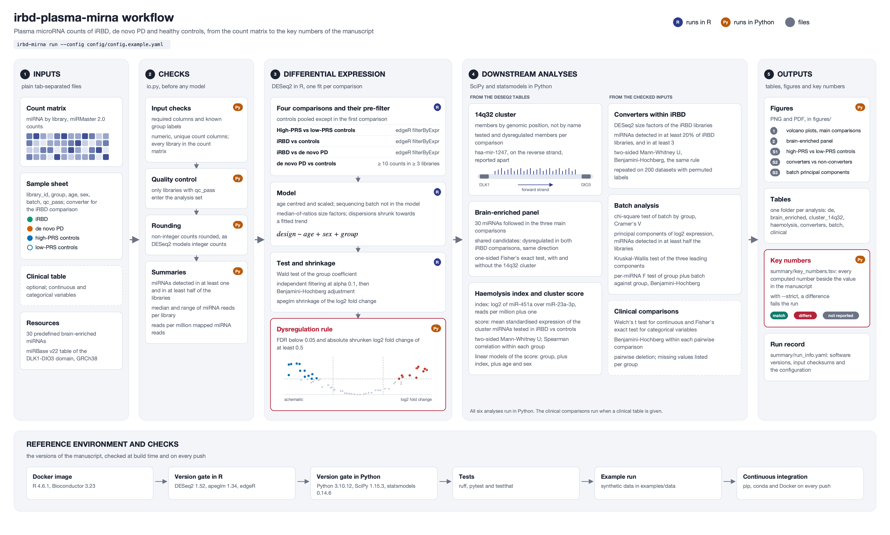
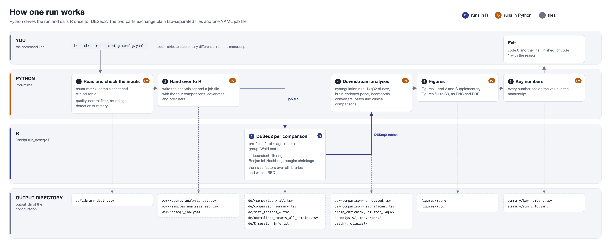

# irbd-plasma-mirna

<p align="center">
  <a href="https://github.com/a7med7emedan/irbd-plasma-mirna/actions/workflows/tests.yml"></a>
  <a href="https://github.com/a7med7emedan/irbd-plasma-mirna/actions/workflows/conda.yml"></a>
  <a href="https://github.com/a7med7emedan/irbd-plasma-mirna/actions/workflows/docker.yml"></a>
  <a href="CHANGELOG.md"></a>
  <a href="LICENSE"></a>
</p>

<p align="center">
  <a href="Dockerfile"></a>
  <a href="Dockerfile"></a>
  <a href="Dockerfile"></a>
  <a href="Dockerfile"></a>
  <a href="Dockerfile"></a>
  <a href="Dockerfile"></a>
  <a href="Dockerfile"></a>
</p>

Statistical analysis code for the study *Parkinson's Disease-Associated Brain-Enriched microRNAs
Reveal Plasma State Biomarkers in Isolated REM Sleep Behaviour Disorder* (Pavelka, Hemedan et al.).
The pipeline takes a plasma microRNA count matrix and a sample sheet. It runs every analysis
described in the Methods section with one command and writes tables, figures and a list of key
numbers.

## Workflow



A text version of the figure is in [docs/workflow.md](docs/workflow.md).

## Intended use

This is research software. It is not a medical device and must not be used for clinical decisions.

## What this repository does not contain

1. No participant data. The study data belong to the Luxembourg Parkinson's Study and the
   Luxembourg RBD Study (NCER-PD) and are available on request, as stated in the manuscript.
2. The dataset in `examples/data` is synthetic.

## What you can do with it

1. Run four DESeq2 comparisons: high-PRS versus low-PRS controls, iRBD versus controls, iRBD versus
   de novo PD, and de novo PD versus controls.
2. Call dysregulated miRNAs with the rule of the manuscript: FDR below 0.05 and absolute shrunken
   log2 fold change of at least 0.5.
3. Summarise the 30 predefined brain-enriched miRNAs, including the candidates shared by both iRBD
   comparisons and a one-sided Fisher's exact test for over-representation.
4. Count tested and dysregulated miRNAs of the 14q32 (DLK1-DIO3) cluster, defined by genomic position.
5. Compute the haemolysis index and the 14q32 cluster score, and test the group difference after
   adjustment for the index, age and sex.
6. Compare converters with non-converters within iRBD, with a permutation check of the
   false-positive rate.
7. Check for a batch effect: balance across groups, principal components and a per-miRNA F test.
8. Compare clinical variables in the five group comparisons of Table 1 and list missing data.
9. Draw the volcano plots, the brain-enriched panel figure and the supplementary figures.
10. Compare every key number of a run with the value reported in the manuscript.

## How it works



DESeq2 runs in R. All other analyses run in Python, as in the manuscript. The modules and their
tasks are listed in [docs/architecture.md](docs/architecture.md). Each Methods statement is linked
to its code and test in [docs/methods.md](docs/methods.md).

## Requirements

1. Docker, for the reference environment. This is the recommended route.
2. Or conda (micromamba, mamba or conda) on Linux or macOS.
3. Or Python 3.10 or newer and R with DESeq2, edgeR, apeglm, yaml and testthat.

## Installation

### Docker, the reference environment

The image holds the software versions stated in the manuscript: R 4.6, DESeq2 1.52 and apeglm 1.34
(Bioconductor 3.23), Python 3.10.12, SciPy 1.15.3 and statsmodels 0.14.6.

```bash
git clone https://github.com/a7med7emedan/irbd-plasma-mirna.git
cd irbd-plasma-mirna
make docker-build
```

### Conda

The conda environment uses the nearest Bioconductor builds on bioconda (R 4.5, DESeq2 1.50.2,
apeglm 1.32.0). Use it when Docker is not available.

```bash
micromamba create -f environment.yml
micromamba activate irbd-plasma-mirna
```

### Manual

```bash
Rscript -e 'BiocManager::install(c("DESeq2", "edgeR", "apeglm")); install.packages(c("yaml", "testthat"))'
make install
```

Details and checks are in [docs/installation.md](docs/installation.md).

## Run the example

One command runs the whole pipeline on the synthetic data.

```bash
make docker-run          # in the reference image, results appear in ./results/example
make run                 # in a local environment
```

The run takes about half a minute. The last log lines name the output directory.

## Run on your own data

1. Prepare the count matrix and the sample sheet as described in [docs/inputs.md](docs/inputs.md).
2. Copy `config/config.study.template.yaml` to `config/config.study.yaml` and set the input paths.
3. Run the pipeline.

```bash
irbd-mirna run --config config/config.study.yaml --strict
```

With Docker, mount the data and the result directory:

```bash
docker run --rm \
  -v /path/to/data:/data:ro \
  -v "$PWD/results:/opt/irbd-plasma-mirna/results" \
  -v "$PWD/config/config.study.yaml:/opt/irbd-plasma-mirna/config/config.study.yaml:ro" \
  irbd-plasma-mirna:1.0.0 run --config config/config.study.yaml --strict
```

`--strict` makes the run fail when a key number differs from the value reported in the manuscript.
The comparison is written to `summary/key_numbers.tsv` in every case.

## Configuration

All settings live in one YAML file. The defaults follow the Methods section.

| Setting | Default | Meaning |
|---|---|---|
| `thresholds.fdr` | 0.05 | FDR limit of the dysregulation rule |
| `thresholds.abs_log2fc` | 0.5 | Limit on the absolute shrunken log2 fold change |
| `deseq2.covariates` | age, sex | Covariates of every DESeq2 model |
| `deseq2.prefilter` | filterByExpr, min_count | Pre-filter per comparison |
| `deseq2.min_count`, `deseq2.min_samples` | 10, 3 | Limits of the `min_count` pre-filter |
| `converters.n_permutations` | 200 | Permuted datasets for the calibration check |
| `manuscript_values` | none | Registry of reported values to compare with |

The full list is in [docs/usage.md](docs/usage.md).

## Outputs

| Directory | Content |
|---|---|
| `de/` | DESeq2 table, annotated table and significant table per comparison |
| `brain_enriched/` | Panel status, shared candidates, over-representation test |
| `cluster_14q32/` | Cluster counts per comparison, other miRNAs of the domain |
| `haemolysis/` | Index, cluster score, tests, correlations and regression models |
| `converters/` | Converter comparison and permutation calibration |
| `batch/` | Batch by group table, principal components, per-miRNA test |
| `clinical/` | Group comparisons and missing-data overview |
| `figures/` | Figures 1 and 2, Supplementary Figures S1 to S3, as PNG and PDF |
| `summary/` | `key_numbers.tsv` and `run_info.yaml` |

Every file is described in [docs/outputs.md](docs/outputs.md).

## Testing

```bash
make lint          # linter and format check
make test          # all tests, including the full pipeline and the R unit tests
make test-fast     # tests that do not need R
make docker-test   # lint and all tests inside the reference image
```

The tests build their own synthetic data. Three workflows run on every push and pull request:

| Workflow | What it checks |
|---|---|
| [Tests](.github/workflows/tests.yml) | Linter, format check and the tests that do not need R |
| [Conda](.github/workflows/conda.yml) | All tests and the example run in the conda environment |
| [Docker](.github/workflows/docker.yml) | Image build with the version checks, all tests and the example run inside the image |

## Documentation

1. [Installation](docs/installation.md)
2. [Usage and configuration](docs/usage.md)
3. [Input formats](docs/inputs.md)
4. [Outputs](docs/outputs.md)
5. [Methods and their implementation](docs/methods.md)
6. [Workflow diagram](docs/workflow.md)
7. [Architecture](docs/architecture.md)
8. [Troubleshooting](docs/troubleshooting.md)

## Citation

Please cite the manuscript and this software. The citation data are in [CITATION.cff](CITATION.cff).

## Licence

The code is released under the Apache License 2.0, see [LICENSE](LICENSE) and [NOTICE](NOTICE).
DESeq2, edgeR and apeglm are used as libraries and keep their own licences.

## Author and contact

Ahmed Hemedan, Luxembourg Institute of Health and Luxembourg Centre for Systems Biomedicine,
University of Luxembourg.

For questions about the code or the analysis, write to
[ahmed.hemedan@lih.lu](mailto:ahmed.hemedan@lih.lu).
