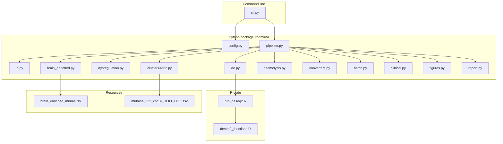
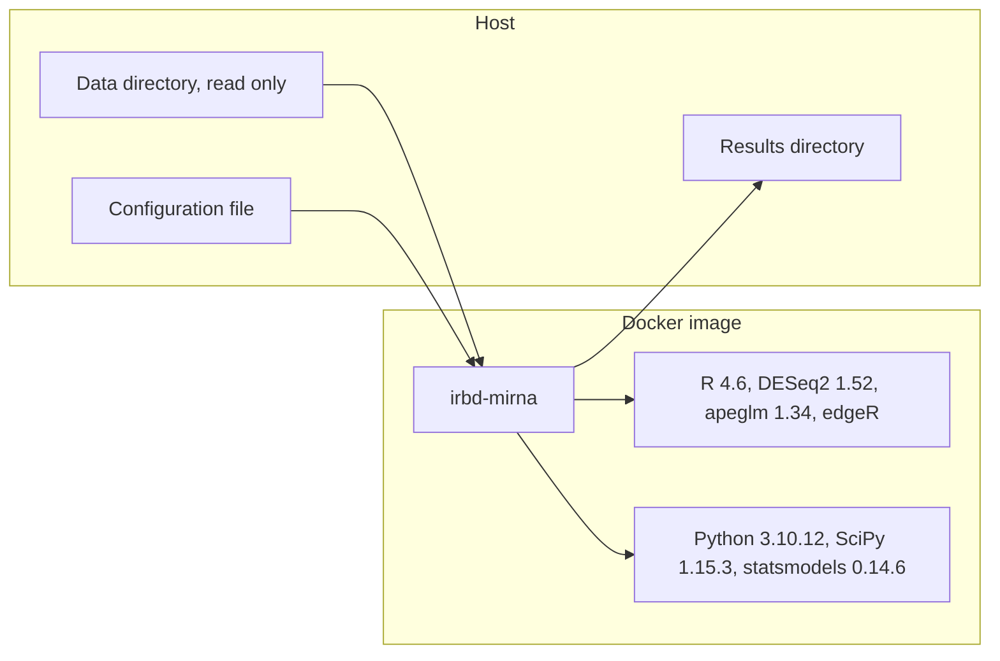

# Architecture

## Components

## Responsibilities

| Module | Responsibility |
|---|---|
| `cli.py` | Parse the command line, set up logging, turn errors into exit code 1 |
| `config.py` | Defaults, YAML loading, validation |
| `io.py` | Read and validate the inputs, round counts, compute reads per million |
| `pipeline.py` | Run the steps in order, write tables, collect the key numbers |
| `de.py` | Define the four comparisons, write the job file, call Rscript |
| `r/deseq2_functions.R` | Pre-filter, design, DESeq2 fit, Wald test, apeglm shrinkage, size factors |
| `r/run_deseq2.R` | Read the job file, run all comparisons, write the tables |
| `dysregulation.py` | Apply the dysregulation rule |
| `brain_enriched.py` | Panel status, shared candidates, Fisher's exact test |
| `cluster14q32.py` | Derive and read the 14q32 table, count cluster miRNAs |
| `haemolysis.py` | Haemolysis index, cluster score, correlations, regressions |
| `converters.py` | Converter comparison and permutation calibration |
| `batch.py` | Batch balance, principal components, per-miRNA F test |
| `clinical.py` | Clinical comparisons and missing-data overview |
| `figures.py` | All figures |
| `report.py` | Key numbers and their comparison with the manuscript values |
| `synthetic.py` | Synthetic example data |

## Design choices

1. DESeq2 runs in R and everything else in Python, as in the manuscript. The two parts exchange
   plain tab-separated files and one YAML job file.
2. Each comparison is fitted on its own subset of libraries. The R script receives the list of
   comparisons and has no study-specific logic.
3. All thresholds live in the configuration. The defaults are the values of the manuscript.
4. Random steps use a fixed seed, so two runs on the same input give the same numbers.
5. Every run records software versions and input checksums in `summary/run_info.yaml`.

## Deployment

