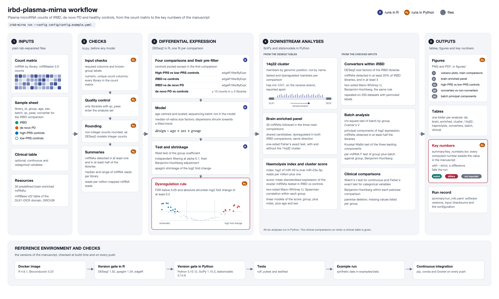
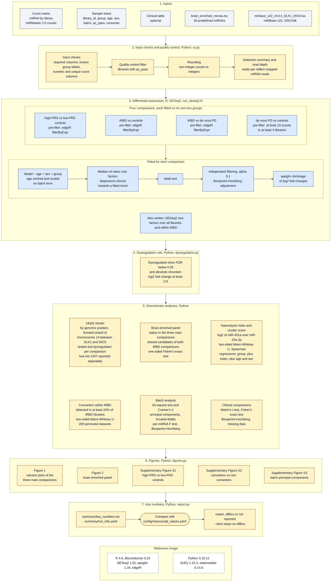

# Workflow

The figure shows every step of `irbd-mirna run`, in the order of `pipeline.run`. Labels and numbers
come from [methods.md](methods.md), `pipeline.py`, `de.py` and `r/deseq2_functions.R`. The defaults
shown are those of `config.py`. The two small plots in the figure are schematic and contain no data.

The figure is drawn by `tools/make_doc_figures.py`, together with `img/how-it-works.png`. Run
`make doc-figures` after a change to the pipeline.

Text version of the diagram

## Legend

1. In the figure, blue tags mark steps in R and amber tags steps in Python. Red frames mark the
   dysregulation rule and the key numbers. Dashed cards are optional. In the text version, blue
   boxes run in R, amber boxes run in Python and grey boxes are inputs.
2. Arrows between stages follow the order of `pipeline.run`. The 14q32 cluster is counted before
   the brain-enriched panel, because the panel test also uses a background without the cluster.
3. Stage 5 also reads the checked inputs of stage 2. The haemolysis index and the batch analysis use
   reads per million mapped miRNA reads. The converter comparison uses the DESeq2 size factors
   within iRBD. The clinical comparisons use the clinical table.
4. Controls are the high-PRS and low-PRS controls pooled. Fold changes are the first-named group
   relative to the second-named group.
5. The batch analysis keeps high-PRS and low-PRS controls apart and uses the leading three
   principal components.
6. The permutation check uses the seed 20260830. The comparison with the manuscript values is
   switched off for the synthetic example data.
